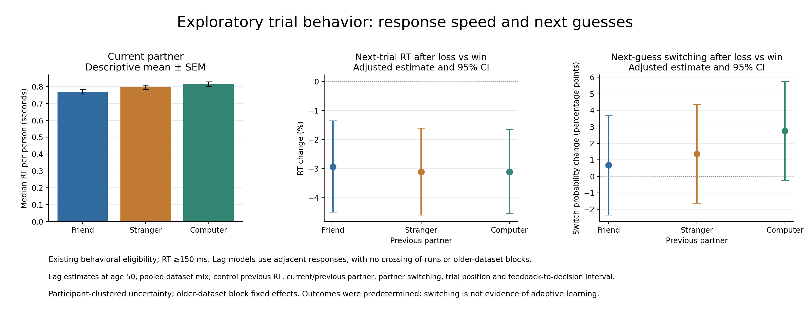
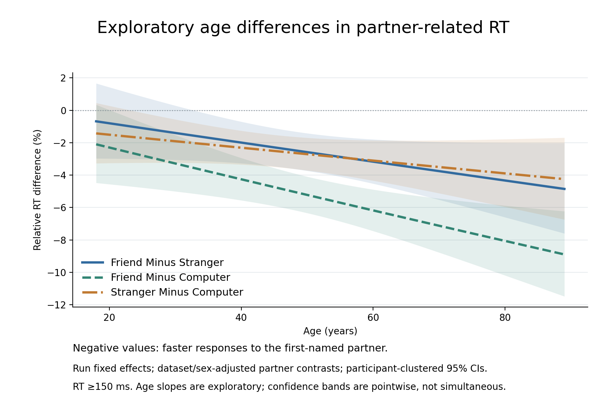
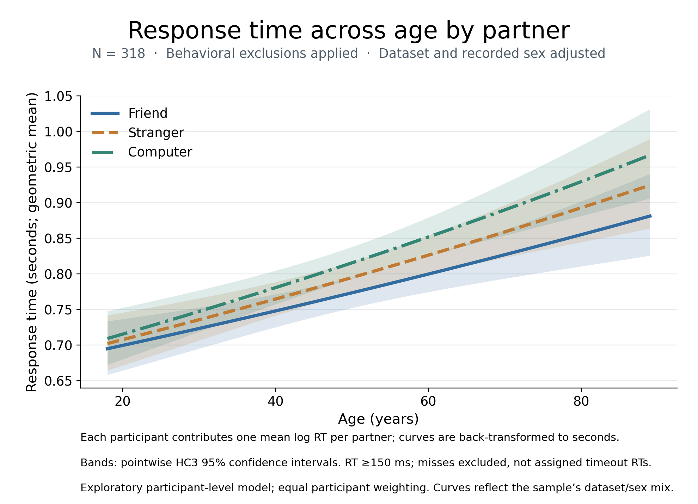
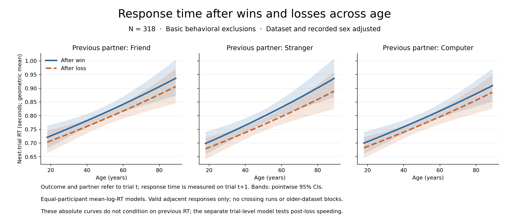
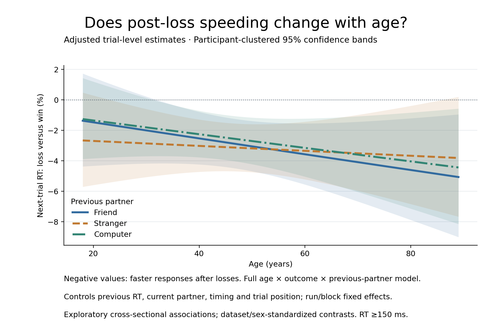

# Exploratory trial behavior

The 2026-10-19 exploration found faster responses with social partners and faster
next-trial responses after losses than wins. It did not establish a pooled
lose-switch guessing effect or a friend-specific post-loss RT effect. These
analyses address response behavior, not the primary subjective-rating hypothesis.

## Sample and source checks

The analysis uses the same 318 participants as the current primary ratings
analysis (285 RF1, 33 ds003745), restricted to their 603 task-ready runs.
There are 33,667 trials, including 603 misses. Missing/invalid/constant ratings
and any partner's loss rating greater than their win rating remain exclusions;
equality is allowed. Task-validity and missed-trial run exclusions remain in
force. MRI motion, coverage and tSNR exclusions are not added to this behavioral
sample. This is therefore not an analysis of every task performer.

RF1 raw logs are resolved and converted in memory using the authoritative
`rf1-sra-linux2` converter. Run totals, misses and all nine partner/outcome
counts must match the current event-QC export. Local RF1 canonical BIDS events
are unavailable, so this does not independently establish per-trial BIDS hash
identity. The older raw logs must match every BIDS event's timing, RT, condition
and block. Sub-144 uses the corrected second logged session. Other concatenated
logs require a unique BIDS-matching session, including sub-145 run 1.
No raw source, BIDS file, imaging model, or exclusion decision is changed.

The [source audit](../qc/trial-behavior-exploratory/source-audit.tsv) records
source hashes, selected logged sessions and verification methods. The local
trial derivative is ignored under `derivatives/behavioral-exploratory/`.

## Models and safeguards

- Current-partner RT: log RT with run fixed effects, partner indicators,
  partner interactions with age, dataset and recorded sex, trial progress and
  squared progress, and older-dataset reward-block context. Partner contrasts
  are evaluated at age 50 and the sample's dataset/sex mix. Age is continuous,
  centered at 50 and expressed per decade. Run intercepts absorb main age,
  dataset and sex offsets; this model does not estimate overall age-related slowing.
- Next-trial RT: log RT conditional on the immediately preceding observed
  outcome. Predictors include previous loss and neutral feedback (win reference),
  loss interactions with age, dataset and previous partner, current/previous
  partner, partner switching, previous log RT, elapsed time from prior outcome
  offset to current decision, and trial progress plus squared progress.
- Next-guess switching: the same lag design, with a binary changed-button
  outcome and a linear probability model. Effects are percentage-point changes,
  not odds ratios. The response-button coding differs across studies but is
  constant within a run; switching compares adjacent buttons within that run.

RF1 lag models have run fixed effects; ds003745 lag models have block fixed
effects and exclude transitions between blocks. All uncertainty uses participant-
clustered CR1 covariance with a finite-sample correction accounting for absorbed
intercepts and t reference degrees of freedom equal to participants minus one.
Tests independently verify this calculation against explicit fixed-effect
regression and statsmodels' cluster covariance.

Lagged variables are formed before filtering. First trials, misses and excluded
RTs never create a connection between nonadjacent trials. Current and previous
responses must both have valid RT for lag modeling. Neutral outcomes are retained
as nuisance observations, not recoded to wins/losses. Trial numbering resets/gaps,
nonmonotonic timing and unexpected response codes fail validation.

The main exploratory RT cutoff is 150 ms, excluding 63 responded trials, with
an all-positive-RT sensitivity analysis. This cutoff is not represented as a
preregistered choice. Misses have missing RT, never a numeric timeout sentinel.
The primary RT models use 33,001 current responses and 31,493 adjacent pairs.
All 318 participants contribute. Results include uncorrected p, Holm correction
within each six-test family, and Holm correction across all 18 tests. Sensitivity
analyses are reported separately; no specification is selected for its p-value.

## Results

At age 50, pooled over the recorded dataset/sex mix, current-trial RT was:

| Comparison | Relative RT difference | Uncorrected p | Holm p across 18 tests |
|---|---:|---:|---:|
| Friend versus stranger | −2.58% | .0000201 | .000301 |
| Friend versus computer | −5.22% | 4.49e−17 | 8.08e−16 |
| Stranger versus computer | −2.71% | .000000321 | .00000514 |

Following a loss rather than a win, next-trial RT was **3.05% faster**
(95% CI 2.00% to 4.09% faster; uncorrected p=3.35e−8), controlling for the
variables above. This effect survives correction across all 18 tests. The
friend-minus-stranger difference in that loss effect was close to zero
(uncorrected p=.854). Next-guess switching increased by 1.60 percentage points,
but its interval includes zero (95% CI −1.02 to +4.22; uncorrected p=.230).

The friend-versus-computer RT ratio declined by about 1.01% per decade
(uncorrected p=.00333; six-test Holm p=.00998; 18-test Holm p=.0466).
The all-positive-RT sensitivity gave about 0.96% per decade (uncorrected
p=.00660), but no longer passed the 18-test correction. Treat this age
interaction as tentative. The friend-versus-stranger age interaction was
not clear (uncorrected p=.0725), nor was age modulation of the post-loss
RT effect (uncorrected p=.0652). Neither survives multiplicity correction.

Overall partner RT and post-loss RT findings persist when very fast responses
are retained. Full estimates, confidence intervals, sensitivity analyses and
null results are in [model tests](../qc/trial-behavior-exploratory/model-tests.tsv).
Omission and switching frequencies are also available as descriptive summaries;
those unadjusted frequencies should not substitute for the lag model estimates.

## Interpretation and figures

These are exploratory associations following the ratings analysis. They are
not replacement evidence for the prediction about subjective pleasure. Faster
responses might reflect attention, familiarity, arousal or motor preparation;
RT alone does not identify valuation. Because feedback was predetermined,
response switching is not evidence of optimal learning or decision accuracy.

The task implementations differ: the older response window is 2.5 seconds and
RF1's is 2.8 seconds; RT timestamping also occurs on different sides of a display
flip. Dataset adjustments and the within-person comparisons reduce, but do not
eliminate, concerns about comparing task versions. The older block structure
also limits generalization of its within-block feedback effect to block changes.

The bar panel shows means of participant-specific median RTs with between-person
SEM. Lag panels show adjusted model effects with 95% confidence intervals.
Age curves show relative partner RT differences, not absolute RT or overall
age-related slowing. Vector SVG versions accompany both figures.

Reproduce locally with `python code/explore_trial_behavior.py`. It reads the
adjacent `rf1-sra`, `rf1-sra-linux2` and `srndna-datapaper` clones and the local
older BIDS event snapshots. Paths can be supplied explicitly using `--help`.
Source and model hashes are in the accompanying
[provenance file](../qc/trial-behavior-exploratory/provenance.json).

## Absolute RT across age

The complementary participant-level analysis in `code/plot_absolute_rt_age.py`
estimates overall age-associated slowing, which the preceding run-fixed-effect
model absorbs. It averages log RT within each participant and partner, then
fits the three paired responses to continuous age, dataset and recorded sex.
Every participant has equal weight; within-participant dependence is preserved
in the HC3 covariance of slope differences. Curves are exponentiated to seconds
(geometric means, not arithmetic means), with pointwise 95% confidence bands.
The same 318 participants and RT cutoff are retained, with an all-positive-RT
sensitivity analysis. This summary model does not additionally control trial
position or block context and does not replace the earlier trial-level results.

Overall RT increases by 3.94% per decade (95% CI 2.44–5.46%; p=3.17e−7).
Partner-specific increases are 3.40% for friend, 3.95% for stranger and 4.46%
for computer. The joint equality-of-slopes test gives p=.0148. Direct paired
age-slope tests give friend versus computer p=.00409 (Holm across three pairs
p=.0123), friend versus stranger p=.111, and stranger versus computer p=.104.
These are exploratory tests in this complementary model, not a fresh
confirmatory family that supersedes the preceding 18-test exploration.
The direction and these pairwise conclusions persist when responses below
150 ms are included.

The result is broad age-associated slowing with modest partner modulation,
not older participants responding faster overall to friends. These are
cross-sectional age associations, not measured within-person aging effects.
See [tests](../qc/trial-behavior-exploratory/absolute-RT-age-tests.tsv) and
[provenance](../qc/trial-behavior-exploratory/absolute-RT-age-provenance.json).

## Next-trial RT after wins and losses across age

The 2026-10-19 follow-up explicitly tests whether age modulation of post-loss
speeding depends on the **previous** partner. It retains all 318 behaviorally
eligible participants and 27,957 valid adjacent win/loss pairs (24,602 RF1;
3,355 ds003745). Outcome and partner refer to trial t; RT is from trial t+1.
Both responses must be positive and at least 150 ms. No trial is bridged after
filtering, no pairs cross runs, and older-dataset pairs stay within blocks.
Previous neutral trials are omitted from this win/loss-focused analysis, not
connected to later responses. No additional imaging QC exclusions were applied.

Two complementary figures answer different questions:

- **Absolute RT:** six participant-specific mean-log-RT outcomes (previous
  partner × previous win/loss), regressed on age, dataset and recorded sex.
  Participants receive equal weight, and exponentiated predictions show
  geometric RT in seconds with pointwise HC3 95% confidence intervals. All six
  cells exist for everyone, although some have only one trial; the cell-count
  audit is retained. These curves do not control previous RT or trial context.
- **Adjusted loss effect:** a trial-level log-RT model with the full age ×
  previous outcome × previous partner interaction and all identifiable
  lower-order terms. Controls include previous log RT, current partner and its
  age interaction, partner switching, feedback-to-decision interval, trial
  progress and progress squared, and loss-by-dataset/recorded-sex terms. RF1
  run and older-dataset run-block fixed intercepts absorb participant-level
  age, sex and dataset offsets. Uncertainty is participant-clustered CR1;
  individual contrasts use t(317), and joint tests use Wald F(2,317).

This extends, rather than silently replaces, the earlier lag model. That model
included neutral feedback as a nuisance category and assumed a common loss-age
slope across partners. This follow-up restricts previous feedback to wins/losses,
adds the requested three-way interaction with lower-order terms, and adds
current-partner age and loss-sex adjustments. Earlier results remain unchanged.

### Results

At age 50, averaging equally across previous partners and standardizing to the
sample's dataset/sex composition, responses are **2.98% faster after losses**
(95% CI 1.91–4.04% faster; uncorrected p=1.28e−7; Holm across all 13 follow-up
tests p=1.66e−6). Partner-specific estimates are 3.05% faster after friend losses,
3.18% after stranger losses and 2.70% after computer losses.

| Direct test | Uncorrected p |
|---|---:|
| Age × previous outcome, averaged across partners | .198 |
| Previous outcome × previous partner, at age 50 | .889 |
| Age × previous outcome × previous partner | .809 |
| Loss-age slope: friend minus stranger | .537 |
| Loss-age slope: friend minus computer | .891 |
| Loss-age slope: stranger minus computer | .613 |

The average loss/win RT ratio changes by −0.39% per decade (95% CI −0.98% to
+0.20%); this is a relative ratio change, not percentage points of RT. The
estimates do not establish equivalent slopes, but do not provide convincing
evidence that speeding differs by age or previous partner. The all-positive-RT
sensitivity retains 28,051 pairs and again shows speeding (3.10%, p=1.68e−7),
without clear age modulation (p=.164) or three-way interaction (p=.730).

All 13 tests are exploratory. The output includes raw p-values, Holm across
all 13, and Holm within the four global tests and each three-test partner
family. Sensitivity corrections are separate. These corrections do not turn
post-hoc follow-up into confirmatory evidence. The behaviorally selected sample,
different task implementations and cross-sectional age design remain important
limitations. Post-loss speeding is not uniquely evidence of valuation or learning.

Reproduce with `python code/plot_next_trial_rt_age.py` after generating the
source-verified trial derivative. The script verifies its SHA-256 fingerprint.
See [tests and intervals](../qc/trial-behavior-exploratory/next-trial-RT-age-tests.tsv),
[cell counts](../qc/trial-behavior-exploratory/next-trial-RT-age-cell-counts.tsv),
and [provenance](../qc/trial-behavior-exploratory/next-trial-RT-age-provenance.json).
Independent tests verify predictions and HC3 intervals, absorbed-model clustered
covariance against explicit fixed-effect regressions, interaction contrast
weights and joint tests, and sequence/missing-cell safeguards.
